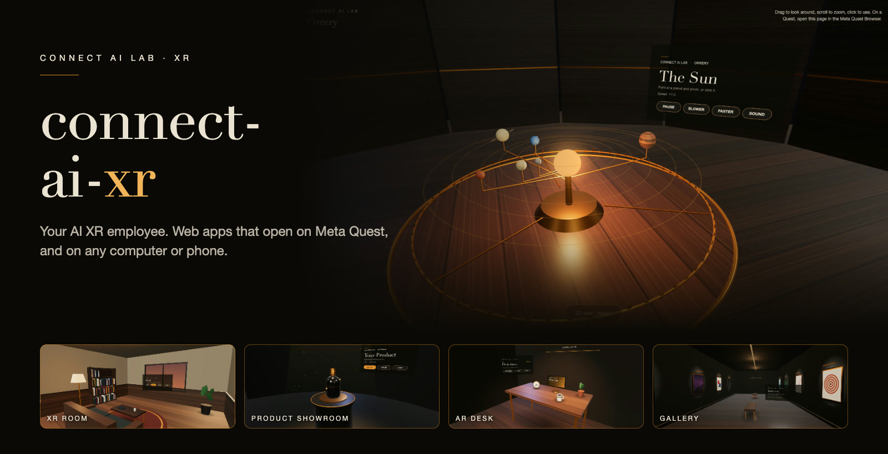
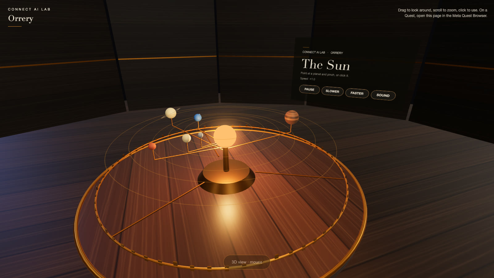
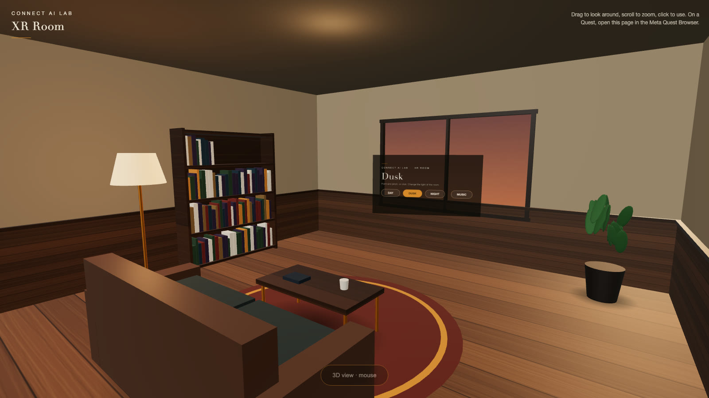
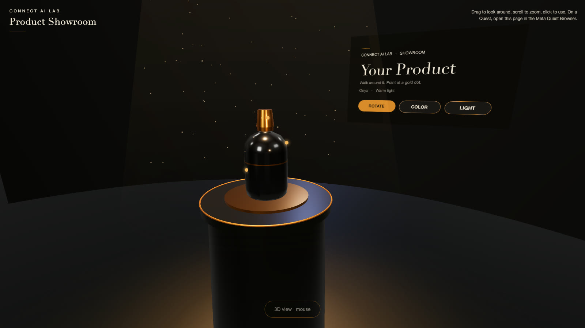
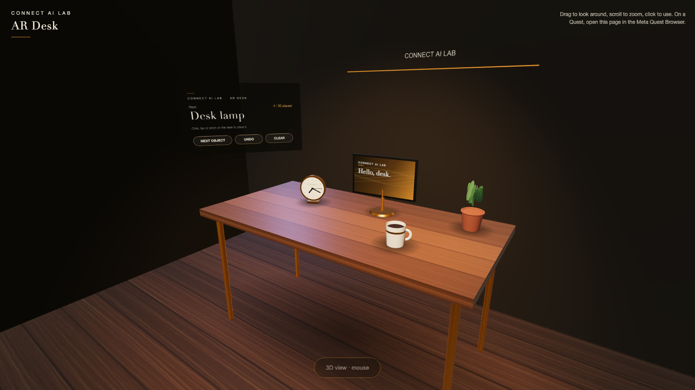
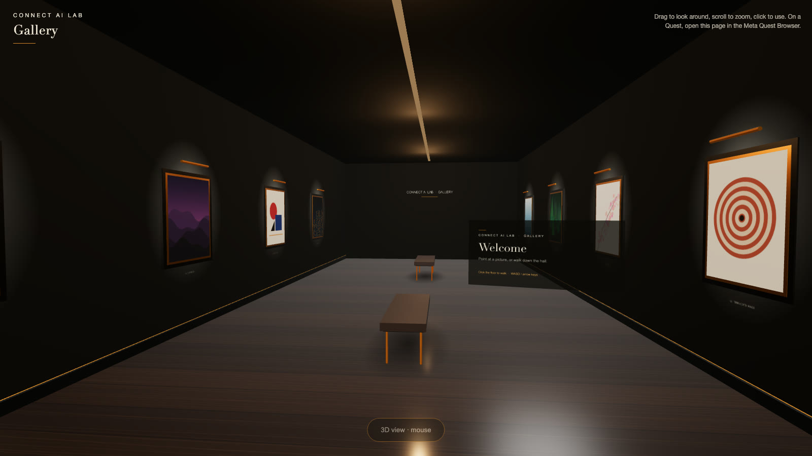

<p align="center"></p>

<p align="center">
  <b>CONNECT AI LAB</b> · 모두를 위한 AI 교육 · AI education for everyone<br>
  <a href="https://www.youtube.com/@CONNECT-AI-LAB">YouTube: CONNECT AI LAB</a> · <a href="https://www.aicitybuilders.com/vibecoding">강의: 비주얼 바이브코딩</a> · <a href="README.md">English</a>
</p>

# connect-ai-xr

**XR 직원이에요. 에이전트한테 한 문장만 말하면 메타 퀘스트에서 바로 열리는 XR 앱을 만들어 줘요. 헤드셋이 없어도 컴퓨터랑 폰에서 똑같이 3D로 열려요.**

```bash
npx github:wonseokjung/connect-ai-xr install-skill
```

에이전트(Claude Code, Codex, Antigravity, Cursor) 채팅창에 위 한 줄을 붙여 넣고 설치해 달라고 하세요. 그다음 새 채팅에서 이렇게 말해 보시면 돼요. "내 상품 쇼룸으로 쓸 건데, 퀘스트에서 열리는 XR 앱 하나 만들어 줘."

필요한 건 [Node.js](https://nodejs.org) 18 이상이랑 코딩 에이전트뿐이에요. 유료 API 키도, 게임 엔진도 필요 없어요. 웹페이지 하나가 그대로 XR 앱이 되는 거거든요.

## 바로 써 보는 앱 다섯 개

전부 코드로 그렸어요. 이미지 파일, 3D 모델 파일 하나도 안 들어가 있어요. 아래 화면은 헤드셋 없이 제 컴퓨터에서 그냥 열어 본 모습이에요.

<table>
<tr>
<td width="50%" valign="top"><br><b>orrery</b> · 행성 모형<br><sub>나무 테이블 위에서 행성이 돌아요. 손가락으로 행성을 집으면 행성마다 다른 소리가 나요.</sub></td>
<td width="50%" valign="top"><br><b>xr-room</b> · 나무 방<br><sub>공중에 떠 있는 유리 패널을 눌러서 낮, 노을, 밤 조명을 바꿔요. AR로 들어가면 벽은 사라지고 가구만 내 방에 남아요.</sub></td>
</tr>
<tr>
<td width="50%" valign="top"><br><b>product-showroom</b> · 상품 쇼룸<br><sub>사업하시는 분들은 이거부터 해 보세요. 내 상품 3D 모델(.glb)이나 사진을 넣으면 받침대 위에 올라가요. 걸어서 한 바퀴 돌아볼 수 있어요.</sub></td>
<td width="50%" valign="top"><br><b>ar-desk</b> · 내 책상 AR<br><sub>퀘스트 3, 3S에서는 진짜 내 책상이 보이고, 그 위에 모니터, 화분, 시계를 손가락으로 집어서 올려요.</sub></td>
</tr>
<tr>
<td width="50%" valign="top"><br><b>gallery</b> · 갤러리<br><sub>내 사진을 걸어 두고 걸어서 둘러보는 전시장이에요. 바닥을 가리킨 다음 엄지랑 검지를 맞대서 집으면 거기로 순간이동하거든요.</sub></td>
<td width="50%" valign="top"><b>기기마다 알아서 맞춰 줘요</b><br><sub>퀘스트 3, 3S는 AR(내 방이 보이는 화면)이랑 VR 둘 다 되고, 퀘스트 2는 VR로 열려요. 폰이랑 컴퓨터에서도 터치나 마우스로 똑같이 돌려 볼 수 있어요.</sub></td>
</tr>
</table>

## 퀘스트에서 여는 법

```bash
npx github:wonseokjung/connect-ai-xr demo
```

이렇게 치시면 주소가 두 개 나와요. `http://localhost` 로 시작하는 건 내 컴퓨터용이고, `https://192.168...` 로 시작하는 걸 퀘스트 브라우저에 그대로 치시면 돼요. https 의 s 까지 꼭 쳐 주세요. s 가 빠지면 VR 버튼이 안 나오거든요.

컴퓨터랑 퀘스트는 같은 와이파이에 있어야 해요. 집이나 사무실 와이파이가 좋아요. 처음 켤 때 컴퓨터에 방화벽 창이 뜨면 허용을 눌러 주시고요.

처음 한 번은 퀘스트가 "연결이 비공개로 설정되어 있지 않습니다" 라고 하는데요, 고급을 누르고 맨 아래 192.168...(으)로 이동을 누르시면 돼요. 내 컴퓨터라서 괜찮아요. 그다음에 Enter VR 이나 Enter AR 버튼을 누르시면 바로 그 공간으로 들어가요. 컨트롤러를 내려놓으면 내 손이 보이는데요, 엄지랑 검지를 맞대서 집으면 클릭이에요. 컨트롤러 방아쇠 버튼도 똑같이 돼요.

## 에이전트가 이렇게 일해요

명령은 에이전트가 알아서 쳐요. 여러분들은 말만 하시면 돼요.

1. 내가 말한 거랑 제일 비슷한 앱을 골라서 새 폴더를 만들어요. `new`
2. 말한 대로 고쳐요. 내 사진이나 3D 모델은 폴더에 넣기만 하면 돼요.
3. 헤드셋 쓰기 전에 먼저 혼자 열어 보고 테스트해요. `check`. 에러는 없는지, 퀘스트에서 안 버벅일 만큼 가벼운지 다 확인하고 스크린샷까지 찍어 주거든요.
4. 퀘스트에서 열 주소를 만들어 줘요. `serve`

구글 AI 스튜디오 같은 데서 만든 3D 웹페이지가 있으신가요? 그것도 가져오시면 퀘스트에서 열리게 다 바꿔 줘요.

<!-- team:start -->
## CONNECT AI LAB의 AI 직원들

AI 직원을 하나씩 오픈소스로 만들고 있어요. 필요한 직원부터 데려가 쓰세요.

<table>
<tr><td width="34%" valign="top"><b>사업 해부 직원</b><br><a href="https://github.com/wonseokjung/reversebusiness"><code>reversebusiness</code></a></td><td valign="top">사업 웹사이트 주소 하나 주면 그 사업이 어떻게 돈 버는지 읽어 줘요.</td></tr>
<tr><td width="34%" valign="top"><b>영상 편집 직원</b><br><a href="https://github.com/wonseokjung/connect-ai-video-motion"><code>connect-ai-video-motion</code></a></td><td valign="top">내 영상을 주면 몸을 피해서 빈자리에 모션그래픽을 넣어 줘요.</td></tr>
<tr><td width="34%" valign="top"><b>모션그래픽 직원</b><br><a href="https://github.com/wonseokjung/connect-ai-motion"><code>connect-ai-motion</code></a></td><td valign="top">글 몇 줄 주면 모션그래픽 영상을 만들어 줘요. 찍은 영상은 없어도 돼요.</td></tr>
<tr><td width="34%" valign="top"><b>마케팅팀</b><br><a href="https://github.com/wonseokjung/connect-ai-marketer"><code>connect-ai-marketer</code></a></td><td valign="top">내 브라우저에서 24시간 댓글, 리스닝, 업로드를 맡아요.</td></tr>
<tr><td width="34%" valign="top"><b>글쓰기 직원</b><br><a href="https://github.com/wonseokjung/connect-ai-writer"><code>connect-ai-writer</code></a></td><td valign="top">영상 하나 주면 플랫폼마다 내 말투로 글을 쓰고 사진까지 같이 만들어 줘요.</td></tr>
<tr><td width="34%" valign="top"><b>XR 직원</b> · <b>지금 보는 직원</b><br><a href="https://github.com/wonseokjung/connect-ai-xr"><code>connect-ai-xr</code></a></td><td valign="top">한 문장 주면 메타 퀘스트에서 열리는 XR 앱을 만들어 줘요. 컴퓨터랑 폰에서도 열려요.</td></tr>
</table>
<!-- team:end -->

---

명령은 `npx github:wonseokjung/connect-ai-xr help` 에 다 있어요. 내 컴퓨터가 준비됐는지 궁금하시면 에이전트한테 doctor 해 달라고 해 보세요.

라이선스는 MIT + Commons Clause예요. 코드는 다 공개돼 있는데(소스 공개), 판매는 안 되는 라이선스거든요. 내 사업, 내 채널에 마음껏 쓰고 고치고 나눠도 되고, 이걸로 만든 XR 앱도 다 여러분들 거예요. 안 되는 건 하나예요. 이 도구 자체를 돈 받고 팔거나, 값어치가 전부 또는 거의 이 도구에서 나오는 유료 서비스나 강의를 만들어서 파는 거요. 안에 들어 있는 three.js 는 MIT 라이선스 그대로예요. 자세한 건 [LICENSE](LICENSE) 랑 [NOTICE.md](NOTICE.md) 에 있어요.

이런 도구를 내 AI 에이전트로 직접 만드는 법은 [비주얼 바이브코딩](https://www.aicitybuilders.com/vibecoding)에서 알려 드려요.

<table><tr>
<td width="140" valign="top"></td>
<td valign="top"><b>만든 사람: AI 멘토 제이</b> · CONNECT AI LAB<br>
앞으로도 AI 직원을 하나씩 오픈소스로 풀 거예요. 만드는 법은 유튜브랑 강의에서 다 보여 드려요.<br>
<a href="https://www.youtube.com/@CONNECT-AI-LAB">유튜브</a> · <a href="https://www.aicitybuilders.com/vibecoding">비주얼 바이브코딩</a> · <a href="https://github.com/wonseokjung">다른 오픈소스</a></td>
</tr></table>
