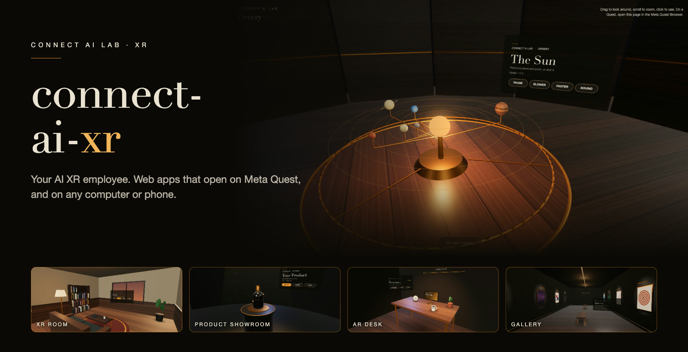
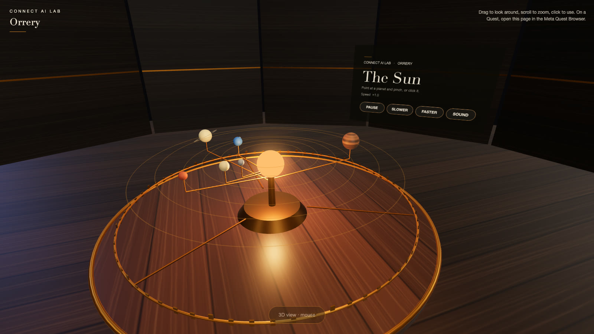
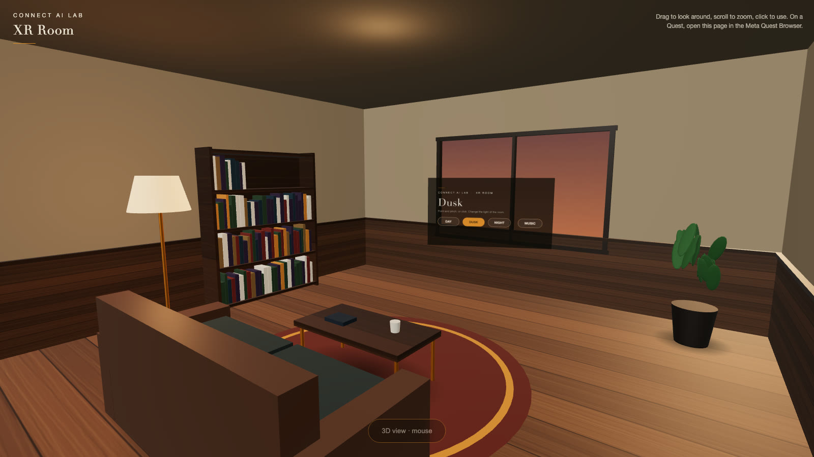
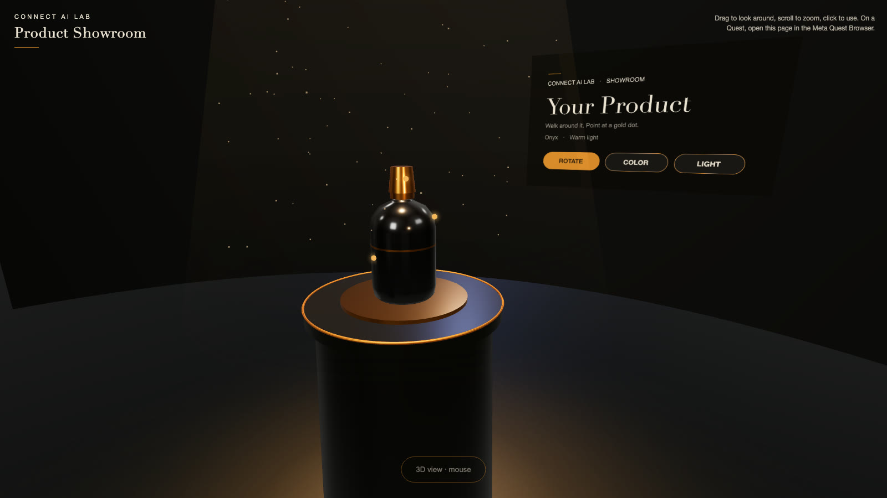
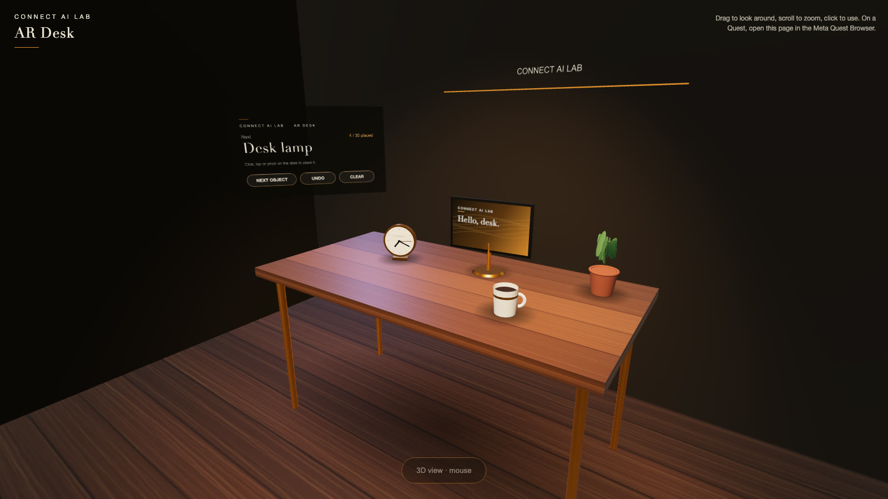
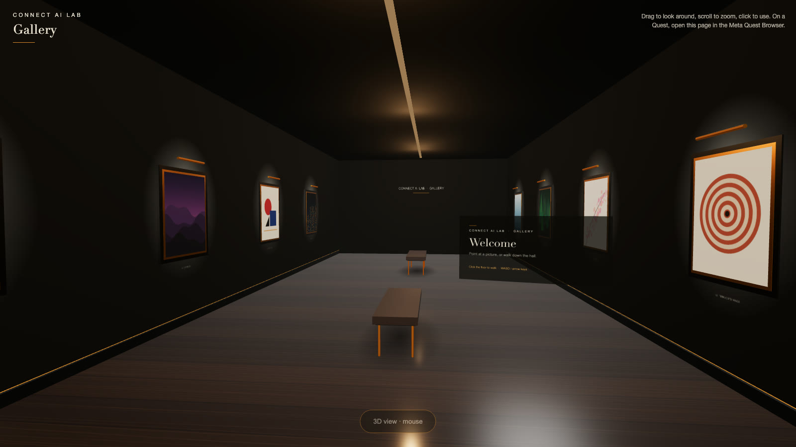

<p align="center"></p>

<p align="center">
  <b>CONNECT AI LAB</b> · AI education for everyone · 모두를 위한 AI 교육<br>
  <a href="https://www.youtube.com/@CONNECT-AI-LAB">YouTube: CONNECT AI LAB</a> · <a href="https://www.aicitybuilders.com/vibecoding">Course: Visual Vibe Coding</a> · <a href="README.ko.md">한국어</a>
</p>

# connect-ai-xr

**Your AI XR employee. Say one sentence to your coding agent and get an XR app that opens on Meta Quest. No headset? The same app opens in 3D on any computer or phone.**

```bash
npx github:wonseokjung/connect-ai-xr install-skill
```

Paste that line into your agent (Claude Code, Codex, Antigravity, Cursor) and ask it to install. Then open a new chat and say: "Make me an XR app I can open on my Quest, a showroom for my product."

You need [Node.js](https://nodejs.org) 18 or newer and a coding agent. No paid API key, no game engine. One web page is the whole app.

## Five apps to start from

All drawn in code: no image or model files inside. These screens are the apps opened on a laptop, no headset.

<table>
<tr>
<td width="50%" valign="top"><br><b>orrery</b><br><sub>Planets turn on a wooden table. Pinch a planet and it plays its own note.</sub></td>
<td width="50%" valign="top"><br><b>xr-room</b><br><sub>A glass panel switches the room between day, dusk and night. In AR the walls go away and the furniture stays in your real room.</sub></td>
</tr>
<tr>
<td width="50%" valign="top"><br><b>product-showroom</b><br><sub>Running a business? Start here. Drop in your product's .glb model or a photo and it stands on a pedestal you can walk around.</sub></td>
<td width="50%" valign="top"><br><b>ar-desk</b><br><sub>On Quest 3 / 3S you see your real desk and pinch a monitor, a plant or a clock onto it.</sub></td>
</tr>
<tr>
<td width="50%" valign="top"><br><b>gallery</b><br><sub>Hang your photos and walk through. Point at the floor and pinch to jump there.</sub></td>
<td width="50%" valign="top"><b>It adapts to the device</b><br><sub>Quest 3 / 3S: AR (you see your room) and VR. Quest 2: VR. Phones and computers: the same scene, turned with a finger or the mouse.</sub></td>
</tr>
</table>

## Open it on your Quest

```bash
npx github:wonseokjung/connect-ai-xr demo
```

You get two addresses. `http://localhost...` is for this computer. Type the `https://192.168...` one into the Meta Quest Browser, with the s: without it there's no VR button.

Computer and headset on the same Wi-Fi (home or office Wi-Fi works best). If your computer asks about the firewall the first time, allow it.

The first time, the headset says "Your connection is not private". Tap Advanced, then "Proceed to 192.168..." at the bottom: it's your own computer. Then press Enter VR or Enter AR. Put the controllers down and you see your hands: thumb and index finger together is a click. The controller trigger works the same.

## How your agent works with it

Your agent types the commands. You just talk.

1. Picks the app closest to what you asked and makes a new folder. `new`
2. Changes it the way you asked. Your photos and models just go in the folder.
3. Opens and tests it before you put the headset on: errors, whether it's light enough for a Quest, and a screenshot. `check`
4. Makes the address for your Quest. `serve`

Made a 3D page somewhere else, like Google AI Studio? Bring it in and your agent moves it onto this setup so it opens on the Quest.

<!-- team:start -->
## The CONNECT AI LAB AI employees

I'm building AI employees one by one, all open. Take the one you need first.

<table>
<tr><td width="34%" valign="top"><b>Business dissector</b><br><a href="https://github.com/wonseokjung/reversebusiness"><code>reversebusiness</code></a></td><td valign="top">Give it one business website and it reads how that business makes money.</td></tr>
<tr><td width="34%" valign="top"><b>Video editor</b><br><a href="https://github.com/wonseokjung/connect-ai-video-motion"><code>connect-ai-video-motion</code></a></td><td valign="top">Puts motion graphics on your own video, in the empty space around you.</td></tr>
<tr><td width="34%" valign="top"><b>Motion graphics</b><br><a href="https://github.com/wonseokjung/connect-ai-motion"><code>connect-ai-motion</code></a></td><td valign="top">A few lines of text in, a motion graphics video out. No footage needed.</td></tr>
<tr><td width="34%" valign="top"><b>Marketing team</b><br><a href="https://github.com/wonseokjung/connect-ai-marketer"><code>connect-ai-marketer</code></a></td><td valign="top">Comments, listening and uploads, 24/7 in your own browser.</td></tr>
<tr><td width="34%" valign="top"><b>Writer</b><br><a href="https://github.com/wonseokjung/connect-ai-writer"><code>connect-ai-writer</code></a></td><td valign="top">One video in, a post for every platform out, in your own voice, with pictures.</td></tr>
<tr><td width="34%" valign="top"><b>XR employee</b> · <b>you are here</b><br><a href="https://github.com/wonseokjung/connect-ai-xr"><code>connect-ai-xr</code></a></td><td valign="top">One sentence in, an XR app that opens on Meta Quest, computers and phones.</td></tr>
</table>
<!-- team:end -->

---

All commands: `npx github:wonseokjung/connect-ai-xr help`. To see what your computer has: `doctor`.

License: MIT + Commons Clause. The code is open to read (source available) but not for resale. Use it, change it and share it for your own business and channel; the XR apps you make with it are yours. The one thing you can't do: sell this tool itself, or sell a paid service or course whose value comes entirely or mostly from it. The bundled three.js stays under its own MIT license. Details in [LICENSE](LICENSE) and [NOTICE.md](NOTICE.md).

How to build tools like this with your own AI agent: [Visual Vibe Coding](https://www.aicitybuilders.com/vibecoding).

<table><tr>
<td width="140" valign="top"></td>
<td valign="top"><b>Made by AI Mentor Jay</b> · CONNECT AI LAB<br>
I'll keep releasing AI employees as open source, one by one, and show how each one is built on YouTube and in the course.<br>
<a href="https://www.youtube.com/@CONNECT-AI-LAB">YouTube</a> · <a href="https://www.aicitybuilders.com/vibecoding">Visual Vibe Coding</a> · <a href="https://github.com/wonseokjung">More open source</a></td>
</tr></table>
